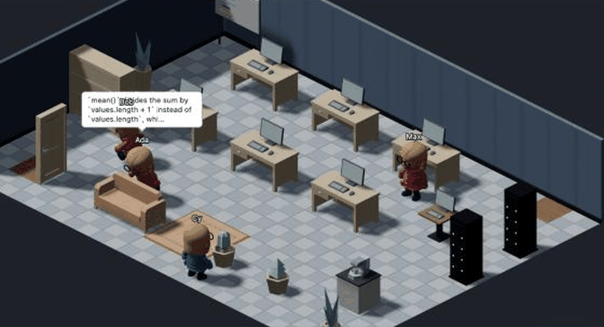

# Deskhaven

An isometric office in stylised low-poly 3D (the original pixel-art renderer is one setting away) where
every avatar is a **real Claude Code agent**. Hire agents at the HR
desk, drop tasks on them from a Kanban board, and watch them walk to the bookshelf when they read, sit at
their desk when they edit, go to the server rack when they run commands, and raise a hand when they need
your permission. Results, diffs and costs land back on the board.



Built on `@anthropic-ai/claude-agent-sdk`: each employee is one SDK session in its own working directory
or git worktree. Local-first, no cloud services besides the Anthropic API your agents talk to.

## Quick start

```bash
pnpm i          # Node >= 22 and pnpm 10 (corepack enable); downloads the SDK's native claude binary (~230 MB)
pnpm dev        # server on http://127.0.0.1:8787, web UI on http://127.0.0.1:5173
```

Open http://127.0.0.1:5173. On first run the app picks an authentication mode (below), prepares a small
sample repository under `~/.deskhaven/sample-repo`, and lets you hire your first agent.

Other commands: `pnpm typecheck`, `pnpm lint`, `pnpm test`, `pnpm build`, `pnpm start` (production
server; set `DESKHAVEN_WEB_DIST=apps/web/dist` to serve the built UI from the same port).

## Authentication: two modes

| | API_KEY | CLAUDE_SUBSCRIPTION |
|---|---|---|
| Who pays | Your Anthropic API account, per token | Your Claude Pro/Max plan usage limits (5-hour and weekly windows) |
| Setup | `ANTHROPIC_API_KEY` in the environment, or paste a key in Settings (stored in the OS keychain, never on disk or in the browser) | Run `claude login` in your own terminal, then pick the mode in Settings |
| What the app does | Passes the key only into the agent subprocess environment | Strips `ANTHROPIC_API_KEY`, `ANTHROPIC_AUTH_TOKEN` and `CLAUDE_CODE_OAUTH_TOKEN` from the subprocess so the plan is used, binds to `127.0.0.1` only, caps concurrency at 2 by default, shows a persistent notice |
| Default | Product default | Preselected on first run when no API key exists and `claude auth status` reports a claude.ai login |

Caveats worth knowing:

- **The HUD cost is an estimate.** It is the SDK's API-equivalent price (`total_cost_usd`) and includes
  prompt-cache writes, so a tiny read-only turn shows tens of cents. In subscription mode nothing is
  billed per token; the number helps you compare agents and set caps.
- **Subscription mode is only for your own login on your own machine.** Deskhaven never builds a login
  UI, never reads, copies or stores OAuth tokens or credential files, and never proxies requests for other
  users. Anthropic's policy on Agent SDK usage with Pro/Max plans changed several times in 2026; the
  current findings and date are in [ARCHITECTURE.md §5.1](ARCHITECTURE.md). The strategy sits behind one
  feature flag (`DESKHAVEN_ENABLE_SUBSCRIPTION_MODE=0` disables it).
- **An API key in the environment silently wins.** If `ANTHROPIC_API_KEY` is set and you choose
  subscription mode, the app strips it for agents; the first session then verifies `apiKeySource === 'none'`
  and stops the agent with an error if a key still reached the process.
- 401/429 responses surface as a sweat-drop or cooldown emote on the avatar plus a notice; the plan's
  5-hour / weekly windows show in the HUD when the SDK reports them.

## What you can do

- **HR desk** — create agents with a name, pixel avatar (skin, hair, outfit, accessory), role preset,
  model, permission mode, working directory (or a dedicated git worktree), system prompt, tool lists and
  budgets. Lifecycle: start, pause, resume, stop, fire. Sessions persist: an agent resumes with its prior
  context after a server restart.
- **Roles** — Architect (read-only, plans), Engineer (edits auto-approved inside the workdir, shell asks),
  Reviewer (read-only), Researcher (web + read), QA (test commands auto-approved), Manager (delegates
  through the board). Presets are editable JSON in Settings.
- **Task board** — Backlog → Assigned → In progress → Needs input → Review → Done. Drag a card onto an
  avatar to assign it. Each card keeps the prompt, assignee, result summary, files changed, cost and
  timestamps.
- **Manager** — give a Manager agent a goal; it lists employees, creates tasks and assigns them through
  in-process MCP tools. Delegation is flat: managers never delegate to managers.
- **Permissions** — the default mode is *ask*. Dangerous tools (Bash, writes outside the workdir) open an
  approve/deny modal wired to the SDK's `canUseTool`; "allow for this session" uses the SDK's own
  suggested rule scoped to the session. Unanswered requests time out into a deny.
- **Safety** — kill switch, per-agent and global daily budgets, per-session `maxTurns` / `maxBudgetUsd`,
  concurrency cap (busy agents), idle processes stopped after a timeout (sessions stay resumable), a
  `PreToolUse` guard that denies edits outside the working directory.
- **Room editor** — place, move, rotate and remove furniture, paint floors and walls; layouts are saved
  to SQLite and behaviours use the live layout (move the bookshelf and the next Read walks there).
- **Inspector and feed** — click an avatar for its live transcript, tool calls, diffs, task and cost; the
  global feed is a chat log of everything that happens. Replay is in M7.

## Architecture in one paragraph

`apps/server` (Fastify, SQLite via better-sqlite3 + Drizzle) is the only process that touches the SDK or
credentials. One `AgentRuntime` per agent drives `query()` in streaming-input mode with hooks and
`canUseTool`; every SDK message and hook is normalised into one typed `AgentEvent` (zod, in
`packages/shared`), appended to an event log and broadcast over WebSocket. `apps/web` (React, Zustand)
maps events to avatar behaviours with a single pure, unit-tested function `mapEventToBehavior`; one
renderer-agnostic simulation core (`apps/web/src/game/core`) drives a small `Scene` port implemented
twice, by Three.js (rigged glTF characters, glTF furniture, soft shadows, DOM bubbles; the default) and
by PixiJS (procedural pixel art). UI panels are plain React. Decisions, verified SDK facts and risks:
[ARCHITECTURE.md](ARCHITECTURE.md). Milestones: [PLAN.md](PLAN.md). Progress: [STATUS.md](STATUS.md).

## Renderers

`three` (3D) is the default. `VITE_RENDERER=pixi pnpm dev` builds with the pixel-art default, and
Settings → Renderer switches either way at runtime (stored in `localStorage`, takes effect on reload).
Both renderers sit behind the same `World` contract, so the editor, the board's drag-and-drop, replay
and the tests do not care which one is mounted; each is a lazily loaded chunk. Add `?stats=1` to the
URL for fps, draw calls and triangles; the Three renderer targets 60 fps with eight animated characters
on a MacBook Air and degrades its shadow map and pixel ratio once if it cannot keep 45. Characters are a
CC0 rigged body (KayKit) recoloured from the avatar you pick at the HR desk, with procedural hair and
accessories; furniture comes from the CC0 Kenney Furniture Kit; licences in [ASSETS.md](ASSETS.md).

## Extending

- **Add a role**: Settings → Role presets → New preset, or add a JSON file to
  `packages/shared/src/presets/` and register it in `presets.ts`. Fields: `systemPrompt` (appended to the
  Claude Code preset), `tools` (array, or `null` for all), `allowedTools` (auto-approved; permission-rule
  syntax such as `Bash(npm test:*)` works), `permissionMode` (`default | acceptEdits | plan | dontAsk`),
  optional `model`, `manager: true` for the delegation tools.
- **Add furniture**: add a kind to `FurnitureKindSchema` in `packages/shared/src/dto.ts` and its spec
  (footprint, `blocks`, `station`, interaction points, placeholder colour/height) to `FURNITURE_CATALOG` in
  `furniture.ts`. The editor, the catalog tests and the Pixi placeholder renderer pick it up; give it a
  `station` and map a behaviour to it in `stationForBehavior`. For the 3D look add a row to
  `MODEL_MANIFEST` in `apps/web/src/game/three/models.ts` (a glTF under `apps/web/public/models/` or a
  procedural builder in `three/procedural.ts`).
- **Add a behaviour**: extend the `Behavior` union and `mapEventToBehavior` in
  `packages/shared/src/behavior.ts` (with a test in `packages/shared/test/behavior.test.ts`), then teach
  the world a pose for it in `apps/web/src/game/pose.ts`, a clip/overlay in `three/anim.ts` and a sprite
  pose in `pixi/avatar.ts`. Tool names are classified in `tools.ts`, so a new tool only needs a category.
- **Swap the art**: 3D models live under `apps/web/public/models/` and are mapped in
  `three/models.ts` (`node scripts/inspect-gltf.mjs file.glb` prints a model's nodes and clips;
  `scripts/strip-character.mjs` trims a character file). The Pixi path keeps its manifest in
  `apps/web/src/game/assets/manifest.ts` (`placeholder`, `generated` pixel sprites or `sheet`). Record
  every file and licence in [ASSETS.md](ASSETS.md).

## Data and privacy

Everything lives under `~/.deskhaven/` (SQLite database, worktrees, the sample repo). Session
transcripts are written by Claude Code itself under `~/.claude/projects/`. Nothing is sent anywhere except
the Anthropic API calls your agents make. Logs redact key-like values.

## License

MIT for this repository's code and generated art. The Claude Agent SDK and the bundled `claude` binary
are governed by Anthropic's terms.
